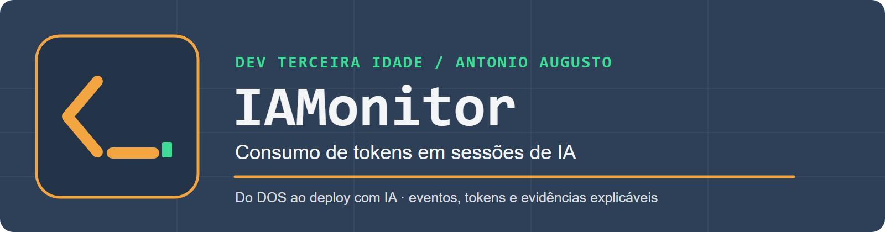

# IAMonitor Desktop

Aplicativo Java para Windows do canal **Dev Terceira Idade**, de Antonio Augusto. Acompanha novas execuções do Codex, Claude Code, Gemini CLI, Cursor Agent e GitHub Copilot CLI, registrando eventos, tokens informados pela ferramenta e arquivos identificados no projeto.

> **Leia cada número pela sua fonte:** tokens da CLI, estimativas locais dos artefatos e cota da assinatura são medidas diferentes.

## Documentação e Wiki

| Comece por | Para entender |
| --- | --- |
| [Visão completa do projeto](docs/wiki/Home.md) | Objetivo, metodologia e mapa das páginas |
| [Primeira execução](docs/wiki/Comece-aqui.md) | Requisitos, comandos e criação de sessão |
| [Visão geral e fluxo](docs/wiki/Visao-geral-e-fluxo.md) | Leitura da execução em tempo real e modo de apresentação |
| [Metodologia dos tokens](docs/wiki/Metodologia-dos-tokens.md) | Equação do total, estados e exemplos auditáveis |
| [Cache e evidências](docs/wiki/Cache-e-evidencias.md) | Origem da contagem e limites do conteúdo observável |
| [Artefatos e simulação](docs/wiki/Artefatos-e-simulacao.md) | Categorias, estimativas e cenários hipotéticos |
| [Provedores e assinatura](docs/wiki/Provedores-e-assinatura.md) | Diferenças entre as CLIs e cota da conta |
| [Dados do projeto e envio](docs/wiki/Dados-do-projeto-e-envio.md) | Pedido, saídas locais e limites do conteúdo remoto |
| [Dados e privacidade](docs/wiki/Dados-e-privacidade.md) · [Relatórios](docs/wiki/Relatorios-e-exportacao.md) | Persistência, JSONL e PDF |
| [Arquitetura](docs/wiki/Arquitetura.md) · [Solução de problemas](docs/wiki/Solucao-de-problemas.md) | Implementação e diagnóstico |
| [Glossário](docs/wiki/Glossario.md) · [Identidade visual](docs/wiki/Identidade-visual.md) | Termos, cores e logos oficiais |

[Abrir o Wiki do GitHub](https://github.com/contatoaugusto/IAMonitor/wiki) · [Consultar as specs](openspec/specs/)

## Baixar para Windows

Na [página de versões do IAMonitor](https://github.com/contatoaugusto/IAMonitor/releases), baixe `IAMonitor-1.0.2-windows.zip`, extraia a pasta `IAMonitor` completa e abra `IAMonitor.exe`. Mantenha `app/` e `runtime/` ao lado do executável. Ao abrir o aplicativo extraído diretamente, as sessões novas ficam, por padrão, em `%LOCALAPPDATA%\IAMonitor\data`; `run.ps1` usa a pasta `data/` deste repositório. Para acompanhar uma IA real, instale e autentique a CLI correspondente na mesma conta do Windows. O código fonte e as instruções de compilação também estão neste repositório.

## Estrutura

| Caminho | Conteúdo |
| --- | --- |
| `src/main/java/br/iamonitor/desktop/` | Aplicativo Swing, integração com as CLIs, armazenamento e PDF. |
| `src/main/resources/` | Configuração da identidade do canal e foto. |
| `src/test/java/br/iamonitor/desktop/` | Testes Java com dados temporários. |
| `data/` | Sessões locais, SQLite e eventos JSONL. Preservada entre builds. |
| `target/` | JAR, aplicativo Windows, ZIP, ferramentas de build e prévias geradas. |
| `pom.xml`, `build.ps1`, `run.ps1` | Compilação e execução. |

`data/` e `target/` são ignorados pelo Git.

## Executar

Abra o PowerShell nesta pasta e rode:

    .\run.ps1

O script usa o aplicativo Windows indicado em `target/current-app.txt` (ou `target/package/IAMonitor/IAMonitor.exe` como alternativa), que inclui o runtime Java. A opção `-DataDir` permite escolher outra pasta para as sessões. Também é possível abrir o executável diretamente ou extrair `target/IAMonitor-1.0.2-windows.zip` em outro computador; mantenha as pastas `app` e `runtime` junto do executável.

Antes da primeira sessão, instale a CLI da IA escolhida e faça login nela no PowerShell com a mesma conta do Windows usada para abrir o IAMonitor. Esse preparo pode ser feito em qualquer pasta. Para Codex e Claude Code, abra respectivamente `codex` ou `claude` e conclua o login; para Gemini CLI, abra `gemini` e escolha **Sign in with Google**; para Cursor Agent, execute `agent login`; para GitHub Copilot CLI, execute `copilot login`. Se a CLI já estiver autenticada, não é necessário repetir o login.

Ao clicar em **Executar e acompanhar**, o IAMonitor inicia uma **nova execução** da CLI selecionada com a pasta do projeto como diretório de trabalho e envia o pedido digitado. Não é preciso entrar manualmente nessa pasta pelo terminal nem iniciar a tarefa na CLI antes. A própria CLI usa o login salvo por ela ou sua configuração de ambiente. O IAMonitor não lê credenciais, não se anexa a sessões já abertas no terminal/editor e não intercepta o tráfego com o servidor. Ele recebe eventos estruturados dessa nova execução e observa os arquivos locais identificados; as medições dependem do que cada CLI informa. O formulário **Nova sessão** apresenta esse fluxo e os limites específicos da IA selecionada. Ao escolher uma pasta que contém `pedido.txt` na raiz, o pedido é carregado no campo para revisão e pode ser editado; texto digitado manualmente não é substituído ao mudar de pasta. A orientação de login aparece diretamente no formulário. O botão **Entenda o fluxo local e remoto** explica a sequência IAMonitor → CLI → modelo remoto → ferramenta → CLI, inclusive o que a trilha consegue comprovar. O modelo processa o contexto no serviço do provedor; ferramentas locais executam leituras, mudanças e testes no computador quando solicitadas. A CLI não envia automaticamente todo o projeto em um único prompt: o contexto pode ser composto e atualizado ao longo de várias interações. A tela **Dados e envio** repete a explicação antes das evidências, sem identificar saída local como corpo HTTPS confirmado. Na tela principal, **Explorar dados e simular** abre eventos, origens e cenários; **Ampliar visão geral** expande a área de acompanhamento.

Guias oficiais de autenticação: [Codex](https://help.openai.com/en/articles/11381614-api-codex-cli-and-sign-in-with-chatgpt), [Claude Code](https://code.claude.com/docs/en/quickstart), [Gemini CLI](https://geminicli.com/docs/get-started/authentication/), [Cursor Agent](https://prod.cursor.com/help/integrations/cli) e [GitHub Copilot CLI](https://docs.github.com/en/copilot/how-tos/copilot-cli/set-up-copilot-cli/authenticate-copilot-cli).

## Compilar

Requer JDK 21 ou superior e Maven 3. Se não estiverem no `PATH`, `build.ps1` utiliza as ferramentas em `target/toolchain/` quando disponíveis.

    .\build.ps1 -AppImage

O comando executa os testes, gera o JAR em `target/` e o aplicativo Windows. Se a versão anterior estiver aberta, o novo pacote vai para uma pasta datada em `target/`; `run.ps1` usa automaticamente o pacote mais recente. Sem `-AppImage`, gera apenas o JAR. Para rodar somente os testes: `mvn test`.

## Painel para demonstração

A aba **Visão geral** acompanha a sessão: operação atual, total reportado pela CLI, um gráfico separado para cada ciclo recente e o catálogo completo de tipos de artefato. Dentro de cada ciclo, barras grandes mostram parcelas que podem ser somadas diretamente: **Entrada sem cache + Cache + Saída + Outros, quando houver = Total**. Raciocínio, quando informado, permanece dentro da Saída e não vira outra barra. Os ciclos podem ser percorridos em uma lista rolável; cartões sem contagem não presumem zero tokens, e cartões com dados divergentes não desenham barras enganosas. No gráfico **Artefatos identificados**, Skill, Agent, Command, Spec, OpenSpec, Hook, Instruções e Arquivo aparecem com nome completo, quantidade de arquivos, estimativa local de tokens e barra, mesmo quando a categoria está vazia. Clique em uma categoria para ver os caminhos e as estimativas individuais dos arquivos identificados nela. Essas estimativas não atribuem aos arquivos uma parcela do consumo real; zero arquivos identificados também não significa consumo zero de contexto. **Apresentar** oculta a barra lateral e amplia a tela principal para apresentação. **Explorar dados** guarda simulação, tabela completa de eventos e origens. **Relatório PDF** fica na barra principal; **Mais ações** reúne reiniciar, excluir e exportar JSONL. O PDF apresenta resumo, fluxo lógico, ciclos reportados, todas as categorias de artefato, recursos locais e registro cronológico completo, com a origem de cada número.

O quadro **Assinatura**, na barra lateral, mostra a IA e o estado da sessão selecionada. Para Codex autenticado com ChatGPT, o IAMonitor consulta os limites oficiais pelo `codex app-server` antes e depois da execução. Ele exibe o percentual usado/restante, a renovação da janela e, quando as leituras são comparáveis, a variação observada em pontos percentuais. Essa variação é da **conta inteira durante o intervalo**, portanto pode incluir outras atividades simultâneas. Se a janela renovar, faltar uma leitura ou a conta não expuser limites do ChatGPT, a variação fica indisponível. A consulta não inicia uma tarefa de IA, usa a autenticação da própria CLI e não guarda credenciais; somente os percentuais e horários são salvos junto da sessão. O botão **Consultar fonte oficial** abre a página do provedor.

Para Claude, Gemini, Cursor e Copilot, o quadro informa que a cota da assinatura está indisponível no fluxo estruturado utilizado pelo monitor e aponta para a consulta oficial. Os tokens da execução continuam visíveis quando a CLI os fornece, mas não são convertidos em saldo ou cobrança. A falha da consulta de cota do Codex não impede a execução da sessão.

Durante a execução, a mesma visão mantém em destaque a operação observada mais recente, seu detalhe, o tempo decorrido, os últimos eventos e os gráficos atualizados. A barra animada indica que o processo ainda está ativo; não representa uma porcentagem de conclusão. A simulação e as tabelas continuam disponíveis em **Explorar dados**.

No simulador, clique em **Skills**, **Agents**, **Specs** ou **Hooks** para retirar ou recolocar essa origem no cenário. O valor reportado pela CLI permanece como referência; o cenário mostra um valor aproximado menor. O desconto usa a estimativa local dos arquivos identificados uma única vez e nunca ultrapassa a entrada sem cache. A CLI não informa a parcela exata desses arquivos no pedido enviado ao modelo, portanto a economia exibida não é uma medição nem uma previsão de cobrança. Origens sem arquivos identificados não entram na simulação.

O menu **Ajuda → Sobre o IAMonitor** e **Mais ações → Sobre o app** abrem uma apresentação da arquitetura, das tecnologias e versões, das decisões centrais e da construção com assistência de IA. Em **IA e tokens**, a tela separa o total da tarefa selecionada das contagens de desenvolvimento. Estas últimas são calculadas a partir do último total cumulativo de cada registro JSONL local do Codex iniciado na pasta do projeto. O cache já está na entrada. A soma cobre somente esses registros locais; não inclui outras IAs, sessões iniciadas fora da pasta nem conversas sem arquivo disponível, e pode incluir outros trabalhos feitos nesta pasta. O botão **Atualizar contagem** relê os registros em segundo plano.

## Como interpretar os números

O botão **Como são medidos os tokens?** abre um diagrama do ciclo completo: prompt, CLI local, contexto escolhido, envio, possível reuso de cache, modelo remoto, resposta, ferramentas locais e conclusão. Ele coloca no fluxo as contagens reais que a CLI informa para a sessão: entrada, cache (parte da entrada), saída e total. O mesmo total aparece no modelo e na conclusão para orientar a leitura; **não some números repetidos entre etapas**. Prompt, arquivos, skills, agents e ações locais ficam como “não separados” ou “não medidos” quando a CLI não fornece uma parcela real isolada. Ele mostra também o projeto e a CLI no computador, o tráfego de dados pela rede e o serviço remoto de IA. As setas indicam o caminho da informação; as barras mostram os tokens de entrada e saída informados pela CLI na sessão. A seta de retorno representa a resposta visível, que pode ser menor que a saída contada pelo modelo. O monitor não mede os bytes enviados ou recebidos pela rede e não pode afirmar que um arquivo identificado foi integralmente enviado ao modelo.

No início de **Fluxo da sessão**, o bloco **Quantas vezes o caminho foi registrado** mostra uma faixa para cada turno/resultado de uso observado: entrada → modelo → saída, cache já incluído na entrada e total daquela unidade. Se uma execução tiver várias unidades reportadas, as faixas repetidas mostram que a entrada foi contabilizada novamente em cada uma. Uma faixa pode abranger várias chamadas internas; o IAMonitor não vê o número exato de requisições de rede, não identifica quais trechos do pedido foram reenviados e não conta fragmentos de resposta como downloads. Quando disponíveis, eventos de mensagem visíveis da CLI aparecem por intervalo; eles não representam pacotes de rede. Para Claude e Gemini, um resultado final pode agregar várias interações. Turnos sem uso ou ainda em andamento aparecem sem atribuir zero tokens. A consulta do guia percorre todos os eventos de turno guardados, mesmo quando a lista recente do painel mostra somente os últimos 500.
**Entrada** é relativa ao modelo no servidor da IA: o conteúdo que ele recebeu para trabalhar: pedido, instruções, histórico e trechos de arquivos ou resultados de ferramentas efetivamente enviados a ela. Não corresponde a todos os arquivos da pasta. **Saída** é a quantidade de tokens gerados pelo modelo remoto, como resposta, comandos, chamadas de ferramentas e possível raciocínio interno. A parte visível da resposta volta à CLI no seu computador. **Saída não é uma medida de download**: nem todo token contado precisa aparecer no texto recebido, e tokens não equivalem a bytes da rede. Em sessões com várias trocas, o contexto pode ser reenviado e contado novamente.

O número principal, **Tokens da CLI**, é o total desta execução conforme os dados emitidos pela CLI escolhida. A conta aparece logo abaixo com parcelas exclusivas: **entrada sem cache + cache + saída + eventual parcela sem detalhamento = total**. Por exemplo, 1.200 de entrada total com 300 de cache e 450 de saída aparecem como **900 + 300 + 450 = 1.650 tokens**. Se a CLI informar 124 no total, mas detalhar 100 de entrada e 20 de saída, a tela mostra explicitamente os **4 tokens sem detalhamento**; o total informado de 124 é preservado. Tokens observados não são valor cobrado nem saldo da assinatura.

- **Cache:** tokens reaproveitados que já fazem parte da entrada total. No gráfico, a entrada é dividida em parte sem cache e parte em cache; a soma volta à entrada total.

- **Raciocínio:** quando a CLI separa esse valor, ele já faz parte da saída. Não some raciocínio outra vez.
- **Final:** execução concluída, todos os resultados com contagem e parcelas coerentes.
- **Parcial:** execução em andamento ou interrompida; o número pode aumentar ou não abranger toda a atividade.
- **Incompleto (≥):** pelo menos um resultado não informou uso. O número mostrado é apenas o mínimo conhecido.
- **Indisponível (—):** a CLI não forneceu contagem. O aplicativo não substitui esse dado por zero ou por estimativa local.
- **Divergência (—):** total e parcelas não fecham; consulte os eventos JSONL antes de usar o número.
- **Histórico sem eventos (—):** sessões antigas com apenas um total salvo não permitem conferir a conta e não são tratadas como número final.
- **Origens e arquivos:** estimativas locais do texto identificado. Não entram no total principal nem demonstram todo o conteúdo enviado ao modelo.
- **Assinatura e cobrança:** a contagem de tokens processados não é saldo de assinatura, crédito consumido ou valor em dinheiro. As CLIs não fornecem esses dados de maneira uniforme; confira o painel oficial da conta.

### Inspeção do cache

Clique em **Cache** no gráfico de um ciclo, na equação do total, na coluna Cache ou na origem cache da aba **Explorar dados**, ou nos indicadores de cache do guia visual. A inspeção abre os resultados de uso separadamente e mostra entrada total, cache lido, entrada sem cache, saída, campos originais disponíveis da CLI e eventos registrados no intervalo. Clique em um resultado para selecionar seus valores, em um evento para ler seu registro e em **Abrir JSON original do resultado** para conferir a fonte. Um resultado de Claude pode mostrar separadamente tokens de cache **lidos** e **criados**; criação não é leitura de cache. Na tela **Sobre → IA e tokens**, a contagem de cache dos registros locais de desenvolvimento abre outra inspeção, com cada registro JSONL e suas leituras cumulativas.

Cache de entrada é reuso de processamento de um trecho de contexto em chamadas ao modelo; não é uma resposta pronta nem um arquivo de cache criado pelo IAMonitor. A CLI pode informar **quantos** tokens foram lidos do cache, mas os eventos disponíveis não identificam **quais** tokens, linhas ou arquivos compuseram o trecho reutilizado. Eventos e arquivos observados podem ajudar a investigar a execução, mas não comprovam que integraram o cache. O monitor também não mede bytes trafegados nem a cobrança da assinatura. As leituras cumulativas do desenvolvimento não devem ser somadas linha por linha: somente a última leitura válida de cada registro compõe o total mostrado.

Na área **Localização e memória**, o inspetor mostra o caminho absoluto do JSONL de eventos gravado pelo IAMonitor, identificado como **registro local, não arquivo de cache**. As CLIs monitoradas não informam o caminho físico, os arquivos ou a quantidade de RAM atribuída ao cache de prompt do provedor. O pico de RAM exibido, quando existe, é a soma amostrada dos processos locais da CLI e de seus filhos no Windows; ele não mede o cache do modelo. Sem amostra, o valor fica indisponível, não zero. A [documentação da API Claude](https://platform.claude.com/docs/en/build-with-claude/prompt-caching) descreve representações KV e hashes temporariamente em memória, mas a sessão da CLI não revela a máquina ou os bytes usados. A [documentação da OpenAI](https://developers.openai.com/api/docs/guides/your-data) descreve também armazenamento interno do serviço para algumas políticas de cache; isso não corresponde a um caminho de arquivo acessível na máquina do usuário.

| IA | Comando estruturado | Uso disponível no monitor |
| --- | --- | --- |
| Codex | `codex exec --json` | Por turno concluído. |
| Claude Code | `claude -p --output-format stream-json --verbose` | Resultado final. |
| Gemini CLI | `gemini -p --output-format stream-json` | Resultado final `stats`. |
| Cursor Agent | `agent -p --output-format stream-json` | Eventos; tokens não garantidos no formato documentado. |
| GitHub Copilot CLI | `copilot -p --output-format json` | Eventos; tokens e créditos não garantidos no formato documentado. |

Fontes dos formatos: [Claude Code](https://code.claude.com/docs/en/headless), [Gemini CLI](https://geminicli.com/docs/cli/headless/), [Cursor Agent](https://docs.cursor.com/en/cli/reference/output-format) e [Copilot CLI](https://docs.github.com/en/copilot/reference/copilot-cli-reference/cli-command-reference).

Os adaptadores de Claude, Gemini, Cursor e Copilot foram verificados com eventos de exemplo. Não houve execução autenticada de cada conta durante os testes. Codex e Claude estavam instalados na máquina de desenvolvimento; as demais CLIs precisam de instalação própria. Em Windows, o executável de uma CLI pode ser indicado com `IAMONITOR_CODEX_BIN`, `IAMONITOR_CLAUDE_BIN`, `IAMONITOR_GEMINI_BIN`, `IAMONITOR_CURSOR_BIN` ou `IAMONITOR_COPILOT_BIN`.

## Metodologia por IA e simulador

Em **Como são medidos os tokens? → Como cada IA conta**, escolha Codex/OpenAI, Claude/Anthropic, Gemini/Google, Cursor ou GitHub Copilot para ver como o texto é tokenizado, como obter uma contagem oficial e o que o monitor não consegue inferir. O botão **Abrir fonte oficial** leva à documentação de cada ferramenta.

O simulador aceita um texto de até 20.000 caracteres e mostra as cinco linhas de comparação. Para OpenAI, calcula localmente os tokens do texto puro na codificação `o200k_base` com JTokkit. Isso é uma contagem dessa codificação, **não** necessariamente do modelo usado pelo Codex nem da requisição inteira. Para Gemini, mostra `≈ caracteres Unicode ÷ 4`, a regra didática aproximada do Google. Para Claude, Cursor e Copilot, mostra `≈` a contagem `o200k_base` **somente como referência comparativa**; esses números não são tokenizações desses provedores. Cursor e Copilot podem usar modelos de outros provedores, de modo que não existe uma contagem única por ferramenta sem conhecer o modelo. Para contagens oficiais de entrada, use o contador da API do modelo correspondente quando disponível; para a sessão executada, use os eventos de uso informados pela CLI.

O texto digitado no simulador não sai do computador e não altera nenhuma sessão. O simulador não lê credenciais nem aciona uma IA. Fontes: [OpenAI](https://developers.openai.com/api/docs/guides/token-counting), [Anthropic](https://platform.claude.com/docs/en/build-with-claude/token-counting), [Google](https://ai.google.dev/gemini-api/docs/tokens), [Cursor](https://docs.cursor.com/models/) e [Copilot CLI](https://docs.github.com/en/copilot/reference/copilot-cli-reference/cli-command-reference).
## Dados e identidade

As sessões ficam em `data/iamonitor.sqlite` e `data/runs/`. **Zerar e executar** apaga as medições da sessão e roda o mesmo pedido novamente; **Excluir sessão** remove o registro e seus dados. Ambas as ações pedem confirmação. O monitor guarda cópias locais de até 1 MB dos arquivos textuais identificados durante a execução, para abrir seus detalhes depois.

A foto de Antonio Augusto e os textos do cabeçalho ficam em `src/main/resources/`. Eles podem ser personalizados com `IAMONITOR_CHANNEL_NAME`, `IAMONITOR_CHANNEL_SUBTITLE` e `IAMONITOR_CHANNEL_LOGO`.

## OpenSpec

`openspec/` contém o contrato e o histórico das mudanças. `openspec/specs/<capacidade>/spec.md` descreve o comportamento entregue; `openspec/changes/<mudanca>/` guarda a proposta, os deltas de specs, as decisões em `design.md` e o checklist de implementação em `tasks.md`. Mudanças concluídas ficam em `openspec/changes/archive/`. As specs iniciais registram o estado encontrado no código e no README; não atribuem decisões históricas não documentadas.

Para cada mudança de comportamento ou arquitetura, crie uma pasta de mudança antes de implementar. Escreva a decisão técnica com motivo e alternativas, defina cenários verificáveis nas specs afetadas, execute as tarefas e testes, valide os arquivos e arquive a mudança após conferir o resultado. Não copie dados de `data/`, prompts reais ou credenciais para os artefatos do OpenSpec.

A CLI pode ser usada sem adicionar Node ao aplicativo Java:

    npm exec --yes --package=@fission-ai/openspec@1.14.1 -- openspec list --specs
    npm exec --yes --package=@fission-ai/openspec@1.14.1 -- openspec new change nome-da-mudanca
    npm exec --yes --package=@fission-ai/openspec@1.14.1 -- openspec validate --all --strict
    npm exec --yes --package=@fission-ai/openspec@1.14.1 -- openspec archive nome-da-mudanca -y

A integração para Codex foi gerada em `.agents/skills/`. Em uma conversa nova, use `openspec-propose`, `openspec-apply-change` e `openspec-archive-change`, ou peça essas etapas em linguagem natural. Consulte `openspec/config.yaml` para as regras locais.
