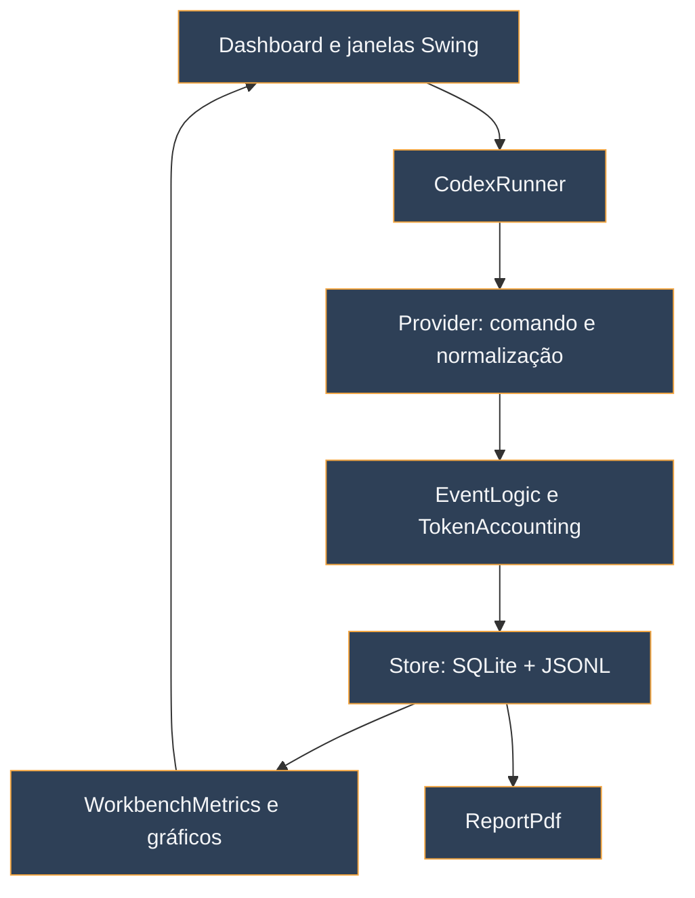

# Arquitetura e decisões técnicas

O IAMonitor é um aplicativo **Java 21 para Windows** com interface Swing. Ele inicia processos CLI, interpreta eventos, persiste o material localmente e monta visualizações e PDF. A arquitetura separa os valores emitidos pelo provedor de estimativas feitas no computador.

## Responsabilidades principais

| Classe ou módulo | Responsabilidade |
| --- | --- |
| `Dashboard` | Apresentação Swing, seleção de sessão, ações do usuário e atualização da tela principal |
| `CodexRunner` | Processo da CLI, leitura da saída e observação de recursos locais |
| `Provider` | Comandos e tradução dos eventos próprios de cada CLI para um formato utilizável |
| `EventLogic` e `TokenAccounting` | Uso, estados da conta e identificação de origens; cache e raciocínio sem dupla contagem |
| `Store` | SQLite, eventos JSONL, artefatos, amostras, cota e compatibilidade de dados anteriores |
| `WorkbenchMetrics` e `WorkbenchCharts` | Valores de apresentação e gráficos de ciclos e categorias |
| `CacheInspector`, `SourceDetails`, `StageDetails` | Inspeção contextual das evidências |
| `SessionFlow` e `UsageGuide` | Explicação do fluxo lógico e dos ciclos reportados |
| `ReportPdf` | Exportação paginada com resumo, fluxo, gráficos e cronologia |
| `TokenMethodology` e `TokenSimulation` | Guia por provedor e comparação local de texto isolado |

## Dados e dependências

O projeto usa `sqlite-jdbc` para persistência, Jackson para JSON, JTokkit para a contagem local `o200k_base`, PDFBox para o relatório e JUnit Jupiter para testes. A interface usa Swing do JDK. O `pom.xml` declara versões e o plugin de empacotamento do JAR; `build.ps1 -AppImage` também gera o aplicativo Windows com runtime.

O fluxo de persistência associa cada evento ao identificador da sessão. O registro original segue para `data/runs/<id>.jsonl`; dados interpretados, artefatos, amostras e leituras de cota ficam no SQLite. A tela pode reabrir uma sessão anterior sem depender de um processo CLI ainda ativo. A UI não deve bloquear a thread de eventos do Swing enquanto uma CLI ou consulta demorada roda.

## Critérios de auditabilidade

- O número principal deriva dos resultados de uso da CLI, com status explícito quando falta dado ou a conta diverge.
- Estimativas de arquivos são calculadas e rotuladas separadamente; não são debitadas do total real.
- A cota de assinatura, quando consultada, pertence à conta e a uma janela, não a um arquivo ou turno isolado.
- JSONL e detalhes da sessão permitem voltar ao evento que sustentou uma contagem.
- O gráfico de fluxo comunica sequência lógica, sem se passar por captura de rede.

## Evolução do projeto

`openspec/specs/` guarda os contratos do comportamento entregue. Cada mudança de comportamento cria uma pasta sob `openspec/changes/` com proposta, decisões, deltas e tarefas, depois arquivada em `openspec/changes/archive/`. Os testes ficam em `src/test/java/br/iamonitor/desktop/` e devem usar diretórios temporários e eventos de exemplo, nunca as sessões pessoais de `data/`.

Para contribuir, execute `mvn test` ou `./build.ps1`, valide a mudança OpenSpec e examine a tela Swing quando alterar layout. A estrutura completa do repositório está no [README](https://github.com/contatoaugusto/IAMonitor#estrutura).
