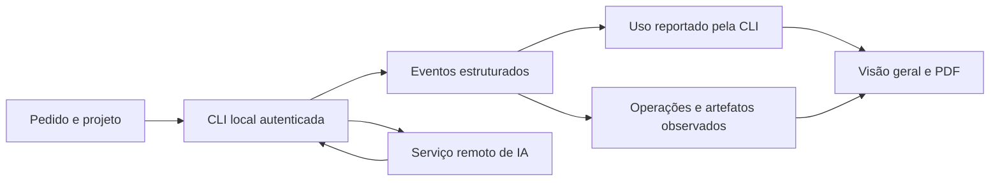

# IAMonitor · tokens e eventos da sessão

**Uma execução, uma trilha de eventos e números que possam ser explicados.** O IAMonitor é um aplicativo desktop para Windows, criado para acompanhar uma tarefa nova executada por uma CLI de IA. Ele apresenta em tempo real as operações, os resultados de uso informados pela ferramenta, os artefatos locais identificados e um relatório PDF que preserva a origem de cada medida.

> **Regra de leitura:** tokens reportados pela CLI, estimativas de arquivos locais e limites da assinatura são três informações diferentes. O IAMonitor as mantém separadas.

## Caminho recomendado

| Se você quer… | Leia |
| --- | --- |
| Entender o propósito e os limites do estudo | [Objetivo e escopo](https://github.com/contatoaugusto/IAMonitor/wiki/Objetivo-e-escopo) |
| Instalar e executar a primeira tarefa | [Comece aqui](https://github.com/contatoaugusto/IAMonitor/wiki/Comece-aqui) |
| Acompanhar o fluxo da execução | [Visão geral e fluxo](https://github.com/contatoaugusto/IAMonitor/wiki/Visao-geral-e-fluxo) |
| Interpretar uma conta de tokens | [Metodologia dos tokens](https://github.com/contatoaugusto/IAMonitor/wiki/Metodologia-dos-tokens) |
| Investigar números de cache | [Cache e evidências](https://github.com/contatoaugusto/IAMonitor/wiki/Cache-e-evidencias) |
| Entender Skills, Agents, Commands e Specs | [Artefatos e simulação](https://github.com/contatoaugusto/IAMonitor/wiki/Artefatos-e-simulacao) |
| Conhecer o que cada IA informa | [Provedores e assinatura](https://github.com/contatoaugusto/IAMonitor/wiki/Provedores-e-assinatura) |
| Auditar os dados do projeto e o envio ao modelo | [Dados do projeto e envio](https://github.com/contatoaugusto/IAMonitor/wiki/Dados-do-projeto-e-envio) |
| Examinar dados, PDF e JSONL | [Dados e privacidade](https://github.com/contatoaugusto/IAMonitor/wiki/Dados-e-privacidade) · [Relatórios e exportação](https://github.com/contatoaugusto/IAMonitor/wiki/Relatorios-e-exportacao) |
| Estudar a implementação | [Arquitetura](https://github.com/contatoaugusto/IAMonitor/wiki/Arquitetura) |
| Resolver um problema | [Solução de problemas](https://github.com/contatoaugusto/IAMonitor/wiki/Solucao-de-problemas) |
| Consultar termos ou a marca | [Glossário](https://github.com/contatoaugusto/IAMonitor/wiki/Glossario) · [Identidade visual](https://github.com/contatoaugusto/IAMonitor/wiki/Identidade-visual) |

## O que uma sessão mostra

O diagrama representa o **fluxo lógico**. As setas não medem bytes de rede, chamadas internas nem o conteúdo exato do contexto em cache.

**Dev Terceira Idade · Antonio Augusto · Do DOS ao deploy com IA.** A identidade visual desta documentação deriva do [kit de marca do canal](https://github.com/contatoaugusto/IAMonitor/wiki/Identidade-visual). O código, as specs e os textos versionados estão no [repositório IAMonitor](https://github.com/contatoaugusto/IAMonitor).
