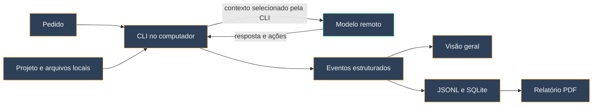

# Visão geral e fluxo da sessão

A **Visão geral** foi desenhada para leitura durante uma execução: estado da sessão, operação em curso, tempo decorrido, total de tokens reportado e gráficos de ciclos e artefatos. **Apresentar** oculta a barra lateral e amplia a área útil sem interromper a tarefa. **Explorar dados** reúne tabelas, origens e simulações, deixando a apresentação principal mais limpa.

*Prévia produzida pelos testes com dados fictícios; os valores não representam uma assinatura real.*

## Do pedido ao resultado

As setas mostram relações lógicas, **não** volume de tráfego. O monitor não observa pacotes, bytes ou a lista exata de arquivos que cada requisição enviou. Ferramentas locais podem executar comandos, ler arquivos e produzir novos eventos entre uma ida ao modelo e outra.

## Como ler os cartões

| Elemento | Leitura correta |
| --- | --- |
| Operação em destaque | Último evento interpretado do processo da CLI |
| Barra animada | Processo ativo; não é percentual de conclusão |
| Tokens da CLI | Total conhecido a partir dos resultados de uso reportados nessa execução |
| Um gráfico por ciclo observado | Uma unidade de uso emitida pela CLI, com parcelas exclusivas |
| Artefatos identificados | Arquivos locais observados por categoria; barras mostram estimativas locais |
| Assinatura | Estado da cota oficial quando houver leitura compatível; separado dos tokens da operação |

Cada cartão de ciclo mostra **Entrada sem cache**, **Cache**, **Saída** e, se necessário, **Outros**. As barras são independentes, com número ao lado, e suas parcelas podem ser somadas para chegar ao total. **Entrada total** é uma informação de referência formada pelas duas primeiras barras; **raciocínio**, quando exposto, é uma parte da saída. [Veja a conta completa.](https://github.com/contatoaugusto/IAMonitor/wiki/Metodologia-dos-tokens)

*Os dados desta imagem também são exemplos criados pelos testes.*

Os cartões recentes podem ser percorridos por rolagem. Uma unidade sem uso informado aparece sem uma barra de zero. Uma unidade com campos contraditórios indica divergência, sem desenhar uma decomposição aparentemente válida. O guia **Como são medidos os tokens?** mostra todas as unidades guardadas para a sessão, mesmo quando a lista recente do painel é limitada.

## Ciclo não é requisição de rede

Um ciclo corresponde ao **turno ou resultado de uso** que a CLI expôs. Em Codex, a contagem pode aparecer por turno concluído. Em Claude e Gemini, um resultado final pode agregar várias interações internas. Assim, três cartões significam três unidades **reportadas**, não necessariamente três requisições HTTP. Mensagens visíveis e operações de ferramenta também não equivalem a pacotes enviados ou recebidos.
